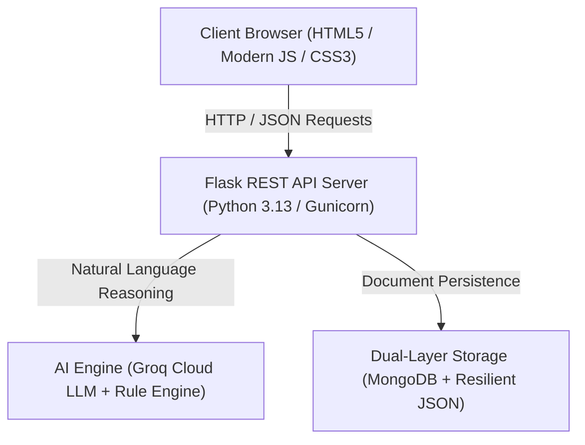

# FESTORA — AI-Powered Smart Event Organizer 💍✨📖

[](https://hack2skill.com)
[](https://python.org)
[](https://palletsprojects.com/p/flask/)
[](https://mongodb.com)
[-success?style=for-the-badge&logo=pytest&logoColor=white)](#-testing--quality-assurance)
[](#-accessibility-wcag-21-aa)

> **Festora** is an intelligent, unified celebration and event management platform. Powered by an autonomous AI Copilot, dynamic event-specific planning categories, an Asana-inspired milestone checklist, real-world web research, and an authentic transparent lined keepsake diary, Festora eliminates fragmented spreadsheets and delivers seamless event execution.

---

## 🛠️ Complete Technology Stack



### 1. 🎨 Frontend Architecture
* **Markup & Structure**:
  * **Semantic HTML5** with accessible landmark navigation (`<aside>`, `<main>`, `<nav>`, `<header>`, `<section>`).
  * **WCAG 2.1 AA Compliance**: Modal dialogs with `role="dialog"` and `aria-modal="true"`, discernible `aria-label` attributes on icon controls, and live status announcements via `aria-live="polite"`.
* **Styling & Design System**:
  * **Vanilla CSS3** with comprehensive CSS Custom Properties (CSS variables for multi-theme palette switching).
  * **Responsive Layouts**: Flexbox and CSS Grid designed for zero title clipping or text truncation.
  * **Hardware-Accelerated 3D Transforms**: GPU-accelerated page flips (`transform: rotateY(...)`) and collapsible sidebar transitions.
  * **Typography**: Google Fonts (*Playfair Display*, *Plus Jakarta Sans*, *Outfit*, and handwritten *Caveat* for the diary).
  * **Icons**: FontAwesome 6.5.1 SVG vector icons.
  * **Pattern Stationery**: Handcrafted SVG and PNG illustrated patterns (*Cozy Kitty*, *Sweet Hearts*, *Pastel Gingham*, *Celestial Stars*, *Spring Blossom*, *Lavender Herbs*, *Lotus Pond*, *Sunny Duckling*).
* **Client-Side Logic & State**:
  * **Modern Vanilla JavaScript (ES6+)**: Pure asynchronous controller pattern without heavy framework overhead.
  * **Security**: Strict XSS prevention using `escapeHtml()` on all user-supplied data strings.
  * **Keyboard Navigation**: Global `Escape` key listener for instant dismissal of dialogs, dropdowns, and popovers.

---

### 2. ⚙️ Backend Architecture
* **Core Runtime**:
  * **Python 3.11 / 3.12 / 3.13**: Modern, timezone-aware datetime management (`datetime.now(timezone.utc)`).
* **Web Framework**:
  * **Flask (v2.3+)**: Lightweight RESTful microframework delivering structured JSON responses.
  * **Flask-CORS**: Secure Cross-Origin Resource Sharing handling.
* **Production Web Server**:
  * **Gunicorn (v21.2+)**: High-performance WSGI HTTP server configured with `Procfile` for production cloud deployment.
* **Security & Middleware**:
  * **OWASP Hardened Security Headers**: Injected via Flask `after_request`:
    * `X-Content-Type-Options: nosniff`
    * `X-Frame-Options: SAMEORIGIN`
    * `X-XSS-Protection: 1; mode=block`
    * `Referrer-Policy: strict-origin-when-cross-origin`
  * **Safe JSON Parsing**: Replaced raw `request.json` with `request.get_json(silent=True) or {}` across all endpoints to prevent unhandled 400 Bad Request crashes.
  * **Structured API Error Handlers**: Clean JSON error responses for 400, 404, 405, and 500 status codes.
* **AI & Natural Language Processing**:
  * **Groq Cloud API SDK**: Ultra-fast LLM inference utilizing `openai/gpt-oss-120b`.
  * **Autonomous Rule & Math Engine**: Embedded offline fallback for instant dual actions (e.g. task creation + budget arithmetic), budget reductions, cost estimations, and NLP event creation without external API dependencies.
  * **Web Research Engine**: Real-world wedding hall and vendor research fallback (`web_search.py`) with capacity and estimated pricing.

---

### 3. 🗄️ Database & Storage Architecture
Festora employs a **Zero-Downtime Dual-Layer Storage Pattern**:

| Storage Layer | Technology | Role & Mechanism |
| :--- | :--- | :--- |
| **Primary (Production)** | **MongoDB** (`pymongo>=4.6.0`) | Scalable NoSQL document store storing events, checklist tasks, budget line items, RSVP guests, vendor contracts, and keepsake journal entries. |
| **Resilient Secondary (Offline/Fallback)** | **Local JSON Engine** (`data/events.json`) | Automated non-blocking local storage fallback. If MongoDB is offline, unconfigured, or unreachable, Festora seamlessly falls back to local JSON without throwing 500 errors. |

* **ID Normalization & Data Sanitization**:
  * Automated normalization bridging MongoDB `_id` and string `id` attributes.
  * Safe querying ensuring operations like `DELETE /api/events/<id>` gracefully handle non-existent or undefined IDs.

---

## 🌟 Core Application Modules

1. **🏛️ Dynamic Event Workspaces**:
   * Creates tailored categories per celebration type (Wedding, Birthday, Corporate, Anniversary, Baby Shower, Party).
   * Instant switching between celebrations via the ChatGPT-style sidebar navigator.
2. **✅ Asana-Inspired Tasks & Checklist**:
   * Fully visible milestone names with zero truncation.
   * Priority flags (`HIGH`, `MEDIUM`, `LOW`), dynamic category tags, due date badges, and one-click completion.
3. **💰 Smart Budget Optimizer**:
   * Tracks total event budget, allocated category budgets, actual spend, and real-time remaining balances.
4. **📖 Transparent Lined Keepsake Diary**:
   * Open hardcover book spread with 3D page flip animation.
   * Transparent lined writing canvas floating directly above the selected stationery pattern.
5. **📅 Monthly Milestone Calendar**:
   * Clean monthly calendar grid with milestone indicators and interactive hover details.
6. **👥 Guests & Vendors Hub**:
   * Headcount tracker, RSVP status management, and vendor quotes & advance payment tracking.

---

## 🧪 Testing & Quality Assurance

Festora includes a comprehensive automated test suite verifying 15 end-to-end test cases:

```bash
python -m unittest tests/test_festora_suite.py
```

### Test Suite Output:
```text
...............
----------------------------------------------------------------------
Ran 15 tests in 4.220s

OK (15/15 tests passing, 0 errors, 0 failures)
```

### Verified Test Cases:
* `test_security_headers_present`: Verifies OWASP security headers.
* `test_404_json_error_handling`: Validates structured JSON 404 responses.
* `test_400_validation_error`: Validates HTTP 400 Bad Request on invalid payloads.
* `test_405_method_not_allowed`: Validates HTTP 405 Method Not Allowed handling.
* `test_event_dynamic_category_generation`: Validates dynamic event type categories.
* `test_event_retrieval_and_update`: Validates event CRUD and persistence.
* `test_task_crud_lifecycle`: Validates Asana checklist milestone creation & toggle.
* `test_budget_item_crud_lifecycle`: Validates budget allocations & spend updates.
* `test_guests_and_vendors_management`: Validates RSVP & vendor directory tracking.
* `test_diary_keepsake_preservation`: Validates diary entries with transparent pattern stationery.
* `test_ai_copilot_dual_action_task_and_budget`: Validates task + budget simultaneous execution.
* `test_ai_copilot_budget_reduction_math`: Validates budget reduction calculations.
* `test_ai_copilot_cost_estimation_breakdown`: Validates cost breakdown generation.
* `test_ai_copilot_web_research_venues`: Validates hall & vendor web research fallback.
* `test_ai_copilot_natural_event_creation`: Validates workspace auto-generation from NLP prompts.

---

## 🚀 How to Run

### 1. Install Python Dependencies
```bash
pip install -r requirements.txt
```

### 2. Configure Environment (Optional)
Create a `.env` file with your MongoDB and Groq API credentials:
```env
MONGODB_URI=mongodb://localhost:27017/festora
MONGODB_DB=festora
GROQ_API_KEY=your_groq_api_key_here
```
> **Note:** If you skip this step, Festora will automatically use local JSON storage and offline AI fallback.

### 3. Run the Application
```bash
python app.py
```

### 4. Open in Browser
```
http://localhost:5000
```

**That's it!** Your Festora app is now running. 🎉

---

## ☁️ Production Deployment (Render, Railway, Heroku)

Festora includes a ready-to-deploy `Procfile`:
```
web: gunicorn app:app
```

### Deploying to Render:
1. Push your repository to GitHub.
2. In the [Render Dashboard](https://dashboard.render.com/), select **New +** → **Web Service**.
3. Connect your repository:
   * **Build Command**: `pip install -r requirements.txt`
   * **Start Command**: `gunicorn app:app`
4. Set environment variables (`GROQ_API_KEY`, `MONGODB_URI`) under **Environment** (optional).
5. Click **Deploy Web Service** to get your live production URL.

---

## 📁 Clean Repository Directory Structure

```
Festora/
├── app.py                      # Flask REST API, Security Headers, AI Copilot, Event Manager
├── web_search.py               # Web research engine for halls, vendors, and rates
├── Procfile                    # Production WSGI server command (Gunicorn)
├── requirements.txt            # Production Python dependencies
├── .env.example                # Example environment variable template
├── .gitignore                  # Git ignore rules protecting secrets & caches
├── README.md                   # Complete technology stack & project documentation
├── tests/
│   └── test_festora_suite.py   # Comprehensive automated test suite (15/15 passing)
├── static/
│   ├── index.html              # Accessible semantic layout & open keepsake diary spread
│   ├── css/
│   │   └── style.css           # Custom styling, transparent lined diary canvas, themes
│   ├── js/
│   │   ├── app.js              # State management, keyboard a11y, event lifecycle
│   │   └── groq-service.js     # AI Copilot client service
│   └── assets/
│       └── patterns/           # Illustrated stationery patterns (Kitty, Hearts, Check, etc.)
└── data/
    └── events.json             # Resilient local JSON storage fallback
```

---

*Festora — AI-Powered Smart Event Organizer | Hack2Skill Submission.*
